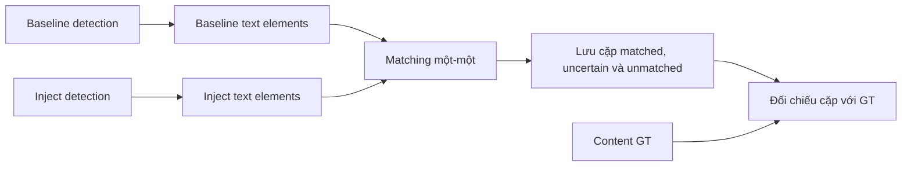

# Thiết kế ghép text element baseline và inject

Đơn vị đầu ra của matcher là **cặp text element trước/sau của cùng một thành phần giao diện**. Matcher chạy độc lập với GT. Bộ chấm đọc các cặp đã lưu và liên kết chúng với GT content theo tọa độ. Lượt đầu dùng 500 ID `000–499` và detection hiện có của hai phía.

## Đầu vào và chuẩn hóa

- Ghép file detection hai phía theo ID mẫu và kiểm tra tọa độ cùng hệ viewport. Mỗi phần tử giữ ID, bbox, nguồn, confidence và chuỗi OCR gốc. Ghi lại bbox sai định dạng để truy vết.
- Lượt đầu lọc `source == ocr` giống lượt audit detection để có cùng tập đầu vào đối chiếu. Nếu một lượt chạy mới có `sources` và `text`, đánh giá việc dùng thêm provenance OCR như một cấu hình riêng. JSON inject cũ thiếu các trường này.
- Giữ hai dạng chuỗi. Chuỗi dùng làm tín hiệu ghép được chuẩn hóa khoảng trắng và hoa/thường. Chuỗi dùng đối chiếu nội dung giữ chữ hoa/thường, dấu câu và số. `description` là trường tùy chọn khi đã có sẵn trong đầu vào. OCR text đủ để chạy lượt đầu.
- Gom detection gần trùng trong từng ảnh trước khi matching. Giữ các ID thành viên và bbox gốc. Việc một đoạn OCR bị tách thành hai dòng được ghi là tình huống segmentation để review.

## Matching baseline ↔ inject

1. **Tìm mốc căn chỉnh.** Dùng text trùng, duy nhất và có vị trí tương thích để ước lượng dịch chuyển cục bộ. Text như “OK” xuất hiện nhiều lần cần thêm ngữ cảnh vị trí.
2. **Tạo ứng viên cặp.** Xét vị trí sau hiệu chỉnh, chiều cao và kích thước vùng chữ, độ chồng lấp, hình ảnh crop và bố cục lân cận. Cho phép chiều rộng thay đổi khi nhãn dài hơn. Độ giống OCR là tín hiệu mềm, vì text có thể đổi hoàn toàn trên cùng nút.
3. **Chọn cặp toàn cục.** Dùng assignment một-một trên ma trận chi phí. Cho phép mỗi phía để unmatched. Kiểm tra độ ổn định bằng cách cấm từng cặp đã chọn rồi giải lại. Nếu phương án thay thế gần tương đương, lưu cặp ở nhóm uncertain.
4. **Lưu kết quả trước khi chấm.** Mỗi `matched_pair` chứa `baseline_id`, `inject_id`, hai bbox, hai chuỗi OCR, điểm và bằng chứng matching. Lưu riêng `uncertain_pairs`, `unmatched_baseline` và `unmatched_inject`. Có thể gắn nhãn `same_text`, `different_text` hoặc `text_unavailable` để phân tích sau matching.

Tái sử dụng chuẩn hóa, duplicate grouping, anchor và solver từ `shared/matching.py`. `content/pipeline.py::content_cost` là điểm khởi đầu cho hàm chi phí. Entrypoint hiện tại đưa toàn bộ detection vào assignment, nên luồng mới cần lọc OCR trước duplicate grouping và giữ classifier thay đổi ra khỏi quyết định ghép. Không dùng điều kiện bbox phải ổn định trong 3 px để xác lập danh tính phần tử.

## Ghép cặp đã lưu với content GT

Bộ chấm lọc bbox GT có nhãn `content` và giữ `original_gt_index`. Với mỗi cặp matched, tính overlap **riêng trên bbox baseline và bbox inject**. Dùng ngưỡng hiện có `IoU ≥ 0,30` hoặc `diện tích giao / diện tích GT ≥ 0,50` cho mỗi đầu cặp. Một link cặp–GT được ghi nếu ít nhất một đầu đạt ngưỡng. Ghi cả hai điểm overlap và trạng thái `baseline_only`, `inject_only` hoặc `both_endpoints`. Giữ từng bbox đầu cặp khi chấm để khoảng trống giữa hai vị trí không trở thành vùng phủ.

Báo hai lớp kết quả trên cùng mẫu số GT:

| Chỉ số | Ý nghĩa |
|---|---|
| GT có detection | Ít nhất một text bbox đạt ngưỡng trong phép chấm độc lập hiện có |
| GT có cặp | Có ít nhất một `matched_pair` với đầu cặp đạt ngưỡng |
| GT có cặp với text khác | Cặp đạt ngưỡng và hai chuỗi OCR khác nhau sau chuẩn hóa khoảng trắng |

Giữ toàn bộ link để audit và đếm mỗi GT tối đa một lần trong từng chỉ số. Nếu GT có thông tin phía, chấm đầu cặp tương ứng. GT hiện tại là bbox flat, vì vậy hai đầu cặp đạt overlap chỉ là bằng chứng định vị. Để xác nhận cặp thực sự cùng phần tử và text thực sự đổi, cần review crop hoặc có nhãn correspondence độc lập.

## Tiêu chí kiểm tra lượt triển khai

- Mọi mẫu xuất kết quả matching trước khi bộ chấm đọc nhãn. Chạy matcher với ảnh và detection mà không cần thư mục GT.
- Hai phần tử có text khác hoàn toàn vẫn có thể được ghép nếu vị trí và ngữ cảnh phù hợp. Hai phần tử trùng text ở vị trí khác nhau có thể được tách bằng bố cục. Cặp mơ hồ và phần tử thiếu phía đối diện có đầu ra riêng.
- Một GT có OCR ở cả hai ảnh nhưng thuộc hai cặp khác nhau được ghi rõ. GT có hai endpoint chỉ được tính `both_endpoints` khi hai bbox thuộc cùng một cặp và cùng đạt ngưỡng với GT đó.
- So kết quả trên đúng 500 mẫu với mốc 105/122 GT có detection ở ít nhất một phía. Phân rã phần giảm thành thiếu detection ở một phía, cặp uncertain hoặc unmatched, và đầu cặp chồng lấp chưa đủ. Báo riêng trường hợp text giống nhau hoặc có nhiễu OCR khi phân tích tập cặp text khác.
