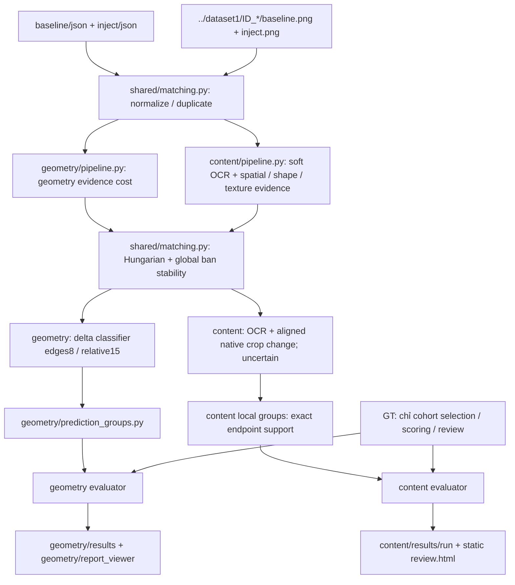

# Cấu trúc sau khi tách geometry / content — 21/10/2026

```text
output_dataset1/
├── geometry/
│   ├── pipeline.py, match_geometry.py, prediction_groups.py
│   ├── pairs/                      # geometry_pairs cũ, nguyên dữ liệu
│   ├── results/                    # geometry_results cũ + run kiểm tra riêng
│   ├── study_first5/               # geometry_study_first5 cũ
│   ├── scripts/, tests/, docs/
│   ├── report_viewer/              # viewer React của geometry
│   └── README.md
├── content/
│   ├── pipeline.py
│   ├── scripts/                    # build_content_report.py, survey_content.py
│   ├── tests/
│   ├── results/
│   │   ├── v1/                     # run trước khi tách, giữ nguyên
│   │   ├── organized_v1/           # chạy lại để kiểm tra đường dẫn/import mới
│   │   └── survey/
│   └── README.md
├── shared/
│   ├── matching.py                 # normalization, duplicate, anchors, crop, assignment, delta
│   ├── regions.py                  # area, intersect, enclosure, exact rectangle union
│   ├── paths.py                    # đọc path provenance lịch sử sau di chuyển
│   ├── scripts/check_migration.py   # kiểm tra byte dữ liệu/kết quả đã di chuyển
│   └── tests/
├── baseline/, inject/, groundtruth/# nguồn chung, giữ vị trí và nội dung
├── image_full_hierarchy.{json,png}  # ví dụ upstream chung, giữ nguyên
├── scripts/build_project_inventory.py
├── docs/
│   ├── PROJECT_STRUCTURE.md
│   ├── code_structure.json, file_inventory.csv, DIRECTORY_TREE.txt
│   └── migrations/2026-10-21/      # mapping, code snapshots, validation
└── README.md
```

`__pycache__`, node_modules, dist là cache/dependency/build. Thư mục tests/scripts cũ nếu còn __pycache__ không chứa pipeline thứ ba. Không xóa cache/file không liên quan trong lần tổ chức này.



| Thành phần | Trách nhiệm / giới hạn |
|---|---|
| shared/matching.py | Không chấm GT. Solve assignment bắt buộc nhận cost_builder; không chọn mặc định geometry cho content. |
| geometry/pipeline.py | Giữ geometry cost gate OCR conflict, classifier và evaluator hiện hành; wrapper truyền geometry cost vào solver chung. |
| geometry/prediction_groups.py | Nhóm GT-independent; dùng rectangle helpers từ shared/regions.py. |
| content/pipeline.py | Dùng cost riêng, không OCR exact gate/lock; classifier riêng. GT không truyền vào infer/content_cost/classify/groups. |
| shared/regions.py | Union chính xác, không đếm diện tích trùng; dùng trong cả hai evaluator. |
| shared/paths.py | Resolve prefix đường dẫn cũ khi đọc manifest/audit; không rewrite hash hoặc JSON kết quả lịch sử. |
| content/scripts/* | Review/report dùng GT được phép, không tạo/cập nhật prediction để đạt GT. |

Tài liệu schema geometry cũ giữ tại [geometry/docs/PROJECT_STRUCTURE.md](../geometry/docs/PROJECT_STRUCTURE.md). Các lệnh/path cũ trong artifact lịch sử được giữ để bảo toàn provenance; dùng README mới để chạy. Code snapshot trước khi tách chỉ phục vụ đối chiếu hash, không dùng làm entrypoint.

Tách file giữ nguyên thuật toán và config. Geometry chạy lại scoring cache ở group_coverage_organized_v1, không ghi đè group_coverage_v1. Content chạy lại dưới organized_v1, không sửa v1; toàn bộ tập đã quan sát trước lần chạy lại này, không có tuyên bố độc lập.
