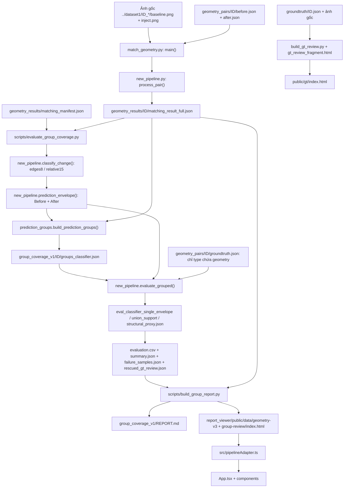
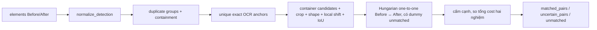

# Geometry — chi tiết schema và workflow

Tài liệu được chuyển từ docs/PROJECT_STRUCTURE.md khi tách project ngày 21/10/2026. Cấu trúc mới: xem ../../docs/PROJECT_STRUCTURE.md và ../README.md; các cây cũ dưới đây là bản mô tả geometry trước khi tách. Schema và quy tắc đánh giá vẫn áp dụng. Tên new_pipeline.py cũ nay tương ứng geometry/pipeline.py + shared/matching.py; prefix geometry_pairs, geometry_results, report_viewer lần lượt là geometry/pairs, geometry/results, geometry/report_viewer.

# Cây thư mục và đường đi dữ liệu hiện hành

Ngày kiểm tra: 18/10/2026. Mã pipeline cũ, evaluator endpoint one-to-one và các script/kết quả lịch sử đã loại bỏ. Không xóa detection, ảnh, GT hoặc matching cache còn dùng. Danh sách xóa: cleanup_2026-10-18.json; hashes nguồn bảo vệ: protected_files_2026-10-18.json.

## 1. Cây thư mục

```text
output_dataset1/
├── match_geometry.py                 # entrypoint CLI
├── new_pipeline.py                   # matcher + classifier + evaluator hiện hành
├── prediction_groups.py              # tạo nhóm độc lập GT, rectangle-union geometry
├── README.md                         # lệnh chạy chuẩn
├── baseline/{json,visualized}/        # dữ liệu upstream Before, không phải matcher cũ
├── inject/{json,visualized}/          # dữ liệu upstream After
├── groundtruth/<ID>.json              # GT gốc, 131 file / 297 bbox
├── geometry_pairs/
│   ├── manifest.json                 # danh sách subset geometry
│   └── <ID>/{before,after,groundtruth}.json
├── geometry_study_first5/             # dữ liệu fixture 000,004,012,016,021
├── geometry_results/
│   ├── matching_manifest.json         # provenance và ID của cache matching
│   ├── <ID>/matching_result_full.json # matched/uncertain/unmatched và evidence
│   └── group_coverage_v1/
│       ├── group_config.json
│       ├── run_status.json / run_manifest.json
│       ├── summary.json / evaluation.csv / REPORT.md
│       ├── failure_samples.json / rescued_gt_review.json / validation.json
│       └── <ID>/
│           ├── groups_edges8.json / groups_relative15.json
│           ├── eval_edges8_single_envelope.json
│           ├── eval_edges8_union_support.json
│           ├── eval_edges8_structural_proxy.json
│           └── eval_relative15_<mode>.json
├── scripts/
│   ├── evaluate_group_coverage.py     # hai pha: tạo nhóm toàn tập → chấm GT
│   ├── build_group_report.py          # báo cáo + xuất dữ liệu viewer + review nhóm
│   ├── group_review_page.html         # template trang review nhóm
│   ├── build_gt_review.py             # GT gốc → bộ xem GT đầy đủ
│   ├── gt_review_fragment.html        # template bộ xem GT
│   ├── check_gt_review.mjs            # kiểm tra logic chọn GT/ROI/type, không cần browser
│   └── build_project_inventory.py     # sinh inventory và cấu trúc code
├── tests/
│   ├── test_pipeline.py              # matcher, CLI, classifier, envelope coverage
│   └── test_prediction_groups.py      # grouping, union, proxy, provenance, không đọc GT
├── report_viewer/
│   ├── package.json / package-lock.json
│   ├── index.html / vite.config.* / tsconfig*.json
│   ├── src/
│   │   ├── main.tsx                  # mount React
│   │   ├── App.tsx                   # chọn mẫu/mode, tải JSON và trạng thái
│   │   ├── pipelineAdapter.ts        # schema Python → view model
│   │   ├── types.ts                  # type của view model
│   │   ├── index.css                 # style chung
│   │   └── components/               # các thành phần chỉ hiển thị
│   └── public/
│       ├── data/geometry-v3/          # matching JSON rút gọn, ảnh, eval 3 mode
│       ├── gt/index.html             # trang GT được sinh
│       └── group-review/index.html   # trang review nhóm được sinh
├── docs/                             # sơ đồ, schema, inventory, log dọn
└── image_full_hierarchy.{json,png}     # ví dụ detection upstream; CLI không đọc trực tiếp
```

`node_modules/`, `dist/`, `__pycache__/` là dependency/build/cache, không phải một pipeline khác. `dist` được sinh lại bằng npm run build. Danh sách path đầy đủ nằm trong file_inventory.csv; nhánh lặp `<ID>` được rút gọn ở sơ đồ trên.

## 2. Đường đi dữ liệu cấp file



Script đánh giá từ cache thực hiện hai pha: ghi **toàn bộ groups của 131 mẫu** trước khi đọc GT để scoring. CLI đầy đủ xử lý từng mẫu nhưng nhóm của mẫu luôn tạo trước bước chấm GT. GT có thể dùng để chọn subset geometry và vẽ overlay; không dùng để chọn correspondence hay nhóm.

## 3. Đường đi bên trong matcher



One-to-one vẫn dùng cho correspondence Before–After. Phép chấm prediction/group–GT không dùng one-to-one. Hai bài toán này độc lập.

## 4. Chức năng các file mã nguồn

| File | Input | Xử lý / output |
|---|---|---|
| match_geometry.py | CLI args | Gọi new_pipeline.main, không chứa matcher thứ hai |
| new_pipeline.py | detection, ảnh, config; GT chỉ ở evaluator | Normalize, duplicate, OCR anchor, container candidate, crop, assignment, stability, delta, classifier, envelope, coverage; ghi result/manifest |
| prediction_groups.py | changed matched pairs, toàn bộ matched pairs để tìm parent, image size | Nhóm shared-parent/local-motion; tính union area không trùng; trả groups và member provenance; không đọc file GT |
| scripts/evaluate_group_coverage.py | matching_manifest + matching_result_full + ảnh để lấy size | Tạo/freeze groups; sau đó đọc GT và chấm ba mode cho hai classifier; ghi bảng tổng hợp, FAIL và queue review |
| scripts/build_group_report.py | run hiện hành trong group_coverage_v1 + matching cache | Kiểm tra consistency/hash; tạo REPORT.md, copy payload/ảnh cho viewer, tạo group-review; không chạy matcher |
| scripts/group_review_page.html | JSON GT được nhóm phủ thêm và nhóm thành viên | Trang SVG Before/After, chọn GT/nhóm/ROI; chỉ hiển thị |
| scripts/build_gt_review.py | GT gốc + cache image_paths + matching manifest | Kiểm tra 131 file GT khớp bản geometry_pairs; tạo full GT review và thumbnail inline |
| scripts/gt_review_fragment.html | samples/bboxes/images | Chọn mẫu/GT/type/ROI, vẽ bbox; không sửa GT |
| scripts/check_gt_review.mjs | HTML GT được sinh | Kiểm tra tất cả 297 lựa chọn GT, type filters, ROI và overlay bằng mock DOM |
| scripts/build_project_inventory.py | cây project, AST của Python | file_inventory.csv, code_structure.json, DIRECTORY_TREE.txt |
| tests/test_pipeline.py | dữ liệu tổng hợp/temp | Kiểm tra thuật toán, CLI, ngưỡng, số lượng GT/prediction và không dùng GT trong matcher |
| tests/test_prediction_groups.py | dữ liệu nhóm tổng hợp | Kiểm tra duplicate, motion, parent, exact union, proxy tách biệt, provenance và không đọc file khi grouping |

Cấu trúc hàm, tham số, docstring, import và line của mỗi file Python được sinh tự động trong code_structure.json.

## 5. Cấu trúc các file dữ liệu

### before.json / after.json — bbox XYXY

```json
{
  "image": "tên ảnh nguồn",
  "total_elements": 64,
  "elements": [
    {"id":"fused_0","source":"ocr","class_label":"Search","bbox":[100,100,200,140],"confidence":0.99,"cluster_size":1}
  ]
}
```

Có thể có metadata detector như total_raw_nodes/total_raw_edges. ID hai phía là hai không gian khác nhau; không ghép chỉ vì ID giống nhau. OCR chỉ lấy từ source hợp lệ, không bịa description/confidence.

### groundtruth.json — bbox XYWH

```json
{"pair_id":"000","bboxes":[{"x":100,"y":100,"w":115,"h":40,"selector":"button","type":["geometry"],"fallback":false}]}
```

GT có thể đa nhãn. Chấm geometry lấy bbox có geometry trong type; giữ cả fallback và tọa độ ngoài viewport. Selector chỉ dùng thông tin nhãn/review, không dùng nhóm prediction.

### matching_result_full.json

```text
pair_id, ablation, config
summary: before/after_detections, dup_groups, anchors, container_candidates,
         matched_pairs, uncertain_pairs, unmatched_before/after, crop_available
matched_pairs[] / uncertain_pairs[]:
    before_id, after_id, before_bbox, after_bbox, match_type,
    evidence, delta, change_reasons, quality_flags,
    group_members và original_bboxes của detection
unmatched_before[] / unmatched_after[]: id, bbox, source, ocr_text
evidence_detail: anchors, duplicate_before/after, container_matches,
                 cost_matrix_info.candidate_trace
image_paths: before, after
warnings[]
```

Delta có dx/dy/dw/dh, relative_dw/dh, center_shift và max_edge_shift. `group_members` trong matching là nhóm **duplicate detection**, khác với prediction groups sau classifier.

### groups_edges8.json / groups_relative15.json

```text
config, image_size, selected_predictions, uses_groundtruth=false
groups[]:
    group_id, kind(shared_parent/local_motion), member_prediction_indices
    members[]: prediction_index, before_id, after_id, before_bbox, after_bbox, delta
    before_bbox, after_bbox, prediction_region (bbox bao nhóm)
    member_regions[] (envelope từng thành viên)
    support_area (union chính xác), bbox_area, support_density,
    image_area_ratio, spatial_spread
    parent: null hoặc before_id/after_id/bbox
    all_motion_compatible, needs_human_review
```

Bbox bao nhóm không đồng nghĩa diện tích có bằng chứng. union_support dùng union của member_regions, không dùng diện tích toàn khung nhóm.

### eval_classifier_mode.json

```text
protocol, classifier, coverage_rule, gt_count, covered, pass
predictions, supporting_predictions, unverified
prediction_regions[]: prediction_index, IDs, endpoints, prediction_region
prediction_gt_links[]: mọi cạnh singleton hợp lệ
assignments[]: bằng chứng đại diện cho từng GT, có thể là singleton hoặc group
missed_gt[]
gt_coverage[]: gt_index, original_gt_index, selector, covered,
               prediction_indices, [single_prediction_indices, group_ids]
Với mode nhóm có thêm:
    base_protocol, single_covered, group_count, group_rescued_gt[]
    group_links[]: group_id, gt_index, members, support_iou/ccr,
                   bbox_iou/ccr, evidence_type, needs_human_review
```

`assignments` là tên trường cho bằng chứng đại diện, không phải ràng buộc one-to-one GT. Unverified là số prediction không có bằng chứng hỗ trợ GT; không được lấy n−covered.

### Tổng hợp và provenance

| File | Cấu trúc / ý nghĩa |
|---|---|
| matching_manifest.json | kind/version, pair_ids, config, inputs[{path,sha256}], thời gian và provenance cache; không chứa điểm cũ |
| group_config.json | ngưỡng grouping đã dùng |
| run_manifest.json | pair_ids, group_config, inputs hashes, phases, thời gian, code hashes, summary |
| run_status.json | status và completed/requested pairs |
| summary.json | classifier → mode → samples/pass/GT covered/predictions/groups/unverified |
| evaluation.csv | mỗi dòng là pair_id × classifier × mode; 131×2×3 = 786 dòng |
| failure_samples.json | mode → [{pair_id,covered,gt_count,missed_gt}] |
| rescued_gt_review.json | [{pair_id,gt_index,mode,groups có member evidence,human_correct:null}] |
| validation.json | consistency, source hashes, grouping-before-scoring; không phải nhãn correctness |

## 6. Viewer và trách nhiệm mỗi file

| File | Trách nhiệm |
|---|---|
| main.tsx | Mount React App vào index.html |
| App.tsx | Fetch manifest/matching/eval; chọn ID/mode, uncertainty, filter và modal |
| pipelineAdapter.ts | Map matched_pairs/uncertain_pairs thành MatchItem; tính giá trị hiển thị từ bbox/delta |
| types.ts | Interface MatchingResult, MatchItem, Delta, Summary, FilterState và các union types |
| components/Header.tsx | Thanh tiêu đề, chuyển view, nút report/JSON |
| components/SummaryCards.tsx | Thống kê detection, correspondence và evidence |
| components/FilterBar.tsx | Filter shift/size/edges8/evidence/text/unmatched |
| components/LegendBar.tsx | Chú giải màu prediction |
| components/SideBySideView.tsx | Hai ảnh, bbox, zoom/pan và chọn phần tử |
| components/OverlayView.tsx | Chồng hai ảnh và bbox để đối chiếu |
| components/ChangeTable.tsx | Bảng matched/unmatched, sort và chọn hàng |
| components/ReportModal.tsx | Hiển thị Markdown dạng text hoặc JSON |
| index.css | Style nền/tokens/layout cơ bản |
| public/data/geometry-v3/manifest.json | ID và summary/mode mặc định của run hiện hành |
| public/data/geometry-v3/ID/matching_result_full.json | Bản copy để xem, bỏ candidate_trace lớn |
| public/data/geometry-v3/ID/eval_mode_edges8.json | Bản copy eval hiện hành cho mode selector |
| public/data/geometry-v3/ID/before.png,after.png | Ảnh gốc copy phục vụ viewer |
| public/data/geometry-v3/group_REPORT.md | Bản xuất báo cáo hiện hành |
| public/gt/index.html | HTML GT độc lập; ảnh gốc + bbox chung Before/After |
| public/group-review/index.html | HTML độc lập xem các nhóm phủ thêm GT |
| package.json / package-lock.json | Lệnh npm và dependency khóa phiên bản |
| tsconfig*.json / vite.config.* | Cấu hình type-check/build/dev server |
| index.html | Host document cho React |

Viewer không tham gia matching/scoring; đổi filter/checkbox chỉ thay cách hiển thị. Structural proxy là thử nghiệm, không mặc định. Không sửa public JSON để sửa kết quả đánh giá.
